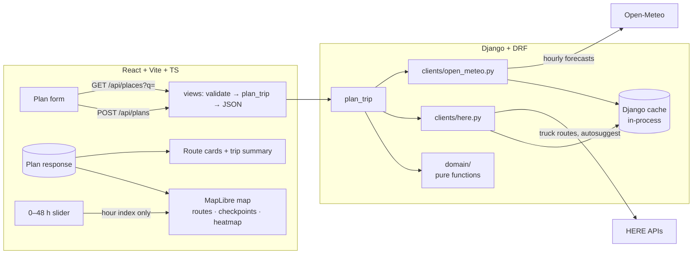

# Architecture

_Drafted 2026-11-13, confirmed 2026-11-15. Built on the decisions in DECISIONS.md._

## 1. Shape of the system

One page, one planning request, one response. After the response arrives, everything the user does (choosing a route, dragging the 0–48 h slider, switching the heatmap variable) happens in the browser with **no further network calls**. That is the main idea behind the "smooth and fast" 40% of the grade.



There is no database. The only state is a short-lived cache of upstream responses.

## 2. Backend

### Layout

```
backend/
  config/                  settings (all config from env), urls, wsgi
  planner/
    domain/                PURE: no Django, no HTTP, no clock. Most tests live here.
      types.py             RiskLevel enum, Weather, Checkpoint, RouteAssessment, … (frozen dataclasses)
      risk.py              classify(weather, load_lb) -> CheckpointRisk
      geometry.py          distance along a polyline, point at distance, simplify
      checkpoints.py       place_checkpoints(route, spacing_mi, departure) -> [Checkpoint]
      ranking.py           rank(assessments) -> Ranking
      stretches.py         merge consecutive checkpoints into "Severe for 18 mi, mile 140–158"
      corridor.py          grid cells within N miles of any route
    clients/               I/O adapters. Parse and validate upstream JSON into domain types.
      here.py              get_truck_routes(...), suggest_places(...)
      open_meteo.py        get_hourly_forecasts(points, start, end)
    service.py             plan_trip(request, *, routing, weather, now) -> Plan
    serializers.py         input validation (DRF) + output camelCasing
    errors.py              AppError types → one JSON error shape
    views.py               two thin views
    tests/                 domain tests + API tests with recorded fixtures
```

**Why this shape** (codebase-design skill):
- **The core is pure.** All the graded logic (risk, checkpoints, ranking) is plain functions over dataclasses, so tests need no mocks, network, or Django.
- **`plan_trip` is the one deep module.** It has a single entry point and receives its dependencies (`routing`, `weather`, `now`) as arguments. Production passes the real clients. API tests pass fakes built from recorded JSON, and a fixed clock. That is two adapters, so the seam is real, not hypothetical.
- **Views stay thin:** validate input → call `plan_trip` → serialize. No logic.

### The planning pipeline (`plan_trip`)

1. **Routes.** HERE Routing v8 with `transportMode=truck`, `alternatives=2` (3 routes total), `departureTime`, and `vehicle[grossWeight]` = load + 35,000 lb tare, converted to kg. We ask for the polyline plus per-piece durations, either spans or actions; the exact parameter is confirmed in the first slice. We use whatever HERE returns: 1–3 routes, no banner.
2. **Timeline per route.** Cumulative (distance → seconds) from those per-piece durations, interpolated linearly by distance inside each piece. This gives a truck-speed ETA at any mile, not a single average speed.
3. **Checkpoints.** At miles 0, s, 2s, …, plus the destination (s = 10/25/50). Each checkpoint has a coordinate, an ETA, and the stretch of road it covers (midpoint to midpoint; the stretches sum to the route length).
4. **Corridor grid.** 0.25° cells (~17 × 14 mi) whose centre is within 30 mi of any route. Used only for the heatmap.
5. **Weather.** One forecast series per unique location:
   - checkpoints, snapped to 0.05° (~3 mi, close to the forecast model's resolution), and
   - grid cell centres.

   Variables: `wind_speed_10m`, `wind_gusts_10m`, `rain`, `showers`, `snowfall`, in `mph` / `inch`, UTC. Every location is fetched for the same fixed range (now → +4 days), so a cached entry always covers any plan's hours (departure up to +48 h plus the trip). Requests are batched (many coordinates per request), run in parallel, and cached for 30 min. Cache key = the rounded location only: checkpoints rounded to the nearest 0.05°, grid cells by their centre on fixed 0.25° lines. Errors are never cached.
6. **Pick the forecast hour.** Open-Meteo's rain and snow at hour T are the total for the hour *ending* at T. So a checkpoint reached at 9:45 uses the 10:00 value, the hour the truck is actually in. Wind uses the same slot.
7. **Classify.** Each condition gets a level from the brief's table (each band starts at its lower bound). The checkpoint level is the worst of the three. Load rules escalate wind only, and the response flags when they did. If a needed value is missing, the checkpoint is `NO_FORECAST` with a reason, never Low.
8. **Assess routes.** Miles per level (including `unknown`), a distance-weighted average (0–4), and the risk stretches with start and end times.
9. **Rank.** Drop routes with any No Travel. Then sort by Severe miles → High miles → average risk → duration. Return the ordered ids, the recommendation, and *which criterion decided it*. If every route has No Travel, `recommendedRouteId` is `null`.
10. **Heatmap frames.** Each cell gets 49 hourly values (now → +48 h): risk level (with the same load rules), wind, rain, and snow.

### API contract (api-and-interface-design skill)

Wire format is JSON with camelCase keys, enums in `UPPER_SNAKE`, times as ISO-8601 UTC, and coordinates as `[lon, lat]` (GeoJSON order).

**`GET /api/places?q=dall`** → `200 { "places": [{ "label": "Dallas, TX, United States", "lon": -96.8, "lat": 32.78 }] }`
HERE Autosuggest restricted to `countryCode:USA` (with `at` = centre of the US, which HERE requires) and `limit=5`, set by our server. The form sends the chosen place's coordinates, so planning never has to geocode free text.

**`POST /api/plans`** (computes and stores nothing; `200`)

```jsonc
// request
{ "origin": { "label": "...", "lon": -96.8, "lat": 32.78 },
  "destination": { "label": "...", "lon": -104.99, "lat": 39.74 },
  "departureAt": "2026-11-14T14:00:00Z",   // now … now+48h
  "loadLb": 32000,                         // 0 … 45,000
  "spacingMi": 25 }                        // 10 | 25 | 50

// response (abridged)
{ "generatedAt": "...",
  "routes": [{
      "id": "r1", "label": "Route A",
      "geometry": [[-96.8, 32.78], ...],     // simplified for display
      "distanceMi": 791.4, "durationS": 47520, "arrivalAt": "...",
      "isDrivable": true,
      "riskMiles": { "low": 610.2, "moderate": 120.0, "high": 61.2, "severe": 0, "noTravel": 0, "unknown": 0 },
      "averageRisk": 0.31,
      "stretches": [{ "level": "HIGH", "fromMi": 140, "toMi": 158, "startsAt": "...", "endsAt": "..." }],
      "checkpoints": [{
          "mile": 25, "coordinates": [-97.1, 32.9], "eta": "...", "coversMi": [12.5, 37.5],
          "risk": "HIGH", "isLoadEscalated": false,
          "conditions": { "wind": "HIGH", "rain": "LOW", "snow": "LOW" },
          "weather": { "windMph": 38.2, "gustMph": 51.0, "rainInHr": 0.02, "snowInHr": 0 },
          "noForecastReason": null }] }],
  "ranking": { "orderedRouteIds": ["r2", "r1", "r3"], "recommendedRouteId": "r2",
               "decidedBy": "HIGH_MILES" },
  "heatmap": { "startsAt": "...(next full hour: the hour bucket that contains now)", "hours": 49, "cellSizeDeg": 0.25,
               "cells": [{ "center": [-97.0, 33.0],
                           "risk": [0, 0, 1, ...], "windMph": [...], "rainInHr": [...], "snowInHr": [...] }] } }
```

`decidedBy` is the criterion that separated the recommended route from the second-best drivable route:

| `decidedBy` | When |
|---|---|
| `SEVERE_MILES` | Fewer Severe miles than the runner-up |
| `HIGH_MILES` | Tied on Severe miles, fewer High miles |
| `AVERAGE_RISK` | Tied on both, lower average risk |
| `DURATION` | Tied on all three, shorter travel time (also used for a full four-way tie, keeping HERE's order) |
| `ONLY_DRIVABLE` | Only one route is drivable |
| `null` | No route is drivable (`recommendedRouteId` is `null`) |

The response has **the same shape in every case**. "No safe route" is `recommendedRouteId: null` with every route `isDrivable: false`, not a different payload. Human-readable sentences ("Severe for 18 mi…", "Chosen for fewer High miles: 10 vs 40") are built in the frontend from these structured fields.

**Errors: one shape everywhere.**

```json
{ "error": { "code": "VALIDATION_ERROR", "message": "Departure must be within the next 48 hours.", "details": { "departureAt": ["..."] } } }
```

| Code | HTTP | When |
|---|---|---|
| `VALIDATION_ERROR` | 400 | Bad input (range, missing field, unsupported spacing) |
| `NO_ROUTE_FOUND` | 422 | HERE returns no truck route between the points |
| `ROUTING_UNAVAILABLE` | 502 | HERE errors, times out, or returns malformed data |
| `WEATHER_UNAVAILABLE` | 502 | Open-Meteo errors, times out, rate-limits, or returns malformed data |
| `INTERNAL_ERROR` | 500 | Anything unexpected (no internals leaked) |

**No fallbacks.** Upstream responses are untrusted. They are parsed into domain types, and any missing or odd field raises `ROUTING_UNAVAILABLE` / `WEATHER_UNAVAILABLE`. Nothing is defaulted, no backup source is used, and there are no automatic retries (the user clicks "Try again"). The one legitimate gap, a forecast value that is genuinely absent, is modelled explicitly as `NO_FORECAST`.

### Configuration (env)

`HERE_API_KEY` (required, fail at startup if missing), `OPEN_METEO_BASE_URL` + `OPEN_METEO_API_KEY` (optional, for the paid tier), `ALLOWED_HOSTS`, `CORS_ALLOWED_ORIGINS`, `DEBUG`. Timeouts: 5 s connect, 15 s read.

## 3. Frontend

### Layout

```
frontend/src/
  api/           client.ts (fetch wrapper → throws ApiError{code,message}), types.ts (mirrors the contract)
  features/
    plan-form/   PlanForm, PlaceInput (autosuggest: searches from the first character, 300 ms debounce, results cached by TanStack Query), DepartureInput, LoadInput, SpacingSelect
    routes/      RouteCards, RouteCard, TripSummary, NoSafeRoute
    map/         MapView, RoutesLayer, CheckpointsLayer, HeatmapLayer, CheckpointPopup
    forecast/    ForecastSlider (+ play), VariablePicker
  lib/           risk.ts (level → colour/label), format.ts (mi, durations, times with tz label),
                 heatmap.ts (cells → GeoJSON with per-hour properties)   ← Vitest covers lib/
  App.tsx
```

**State is kept small and local.** TanStack Query handles the two server calls (loading, errors, cancelling stale autosuggest requests). Selected route, slider hour, and heatmap variable are plain `useState` in `App`. No Redux or Zustand.

### Rendering for smoothness

- **Everything on the map is a MapLibre layer (GPU), not React components.** Hundreds of checkpoints as DOM `<Marker>`s would stutter. As one `circle` layer they don't.
- **Heatmap data is uploaded once.** `lib/heatmap.ts` turns cells into GeoJSON with flat properties `r0…r48`, `w0…w48`, `p0…p48`, `s0…s48`. Moving the slider only changes the paint expression (`['get', 'r12']`), so there's no data re-upload and no React re-render of the map.
- **Rendering style: filled squares.** One `fill` layer, one polygon per cell, built in `lib/heatmap.ts` from `center` + `cellSizeDeg`. Not MapLibre's `heatmap` layer: it blends neighbours and paints in-between colours (looks like Moderate between Low and Severe) that no cell has.
- The selected route is highlighted with a paint expression. Route geometry is simplified server-side.
- Slider: native range input, with a play button that steps hours every ~400 ms. The time label shows clock time in the browser's zone ("Thu 14:00 CST").
- Base map: OpenFreeMap "positron" (light, no API key), so the risk colours stand out.

### Styling

**Tailwind CSS.** It gives a consistent spacing and colour scale, and works with the unslop polish pass.

## 4. Testing

| Where | Tool | What |
|---|---|---|
| `domain/` | pytest | Every band edge (24.9/25, 34.5, 54.9/55; rain 0.25 and exactly 1.00; snow 3.0 vs 3.01), load rules (30,000 vs 30,001 lb, 40,000 vs 40,001 lb), worst-of-three, checkpoint placement (destination included, short last gap), stretches summing to the route length, ETA interpolation, forecast-hour selection (9:45 → 10:00), ranking (No Travel excluded, each tie-break step and its `decidedBy` value incl. `ONLY_DRIVABLE`, all blocked → null) |
| `service` + views | pytest + recorded JSON | Normal plan, validation errors, HERE failure → `ROUTING_UNAVAILABLE`, malformed weather → `WEATHER_UNAVAILABLE`, one consistent error shape. No network. |
| `frontend/src/lib` | Vitest | Formatting, colour scale, heatmap GeoJSON builder |

CI: one GitHub Actions workflow runs ruff + pytest (backend), and ESLint + Vitest + `tsc` + `vite build` (frontend), on every push.

## 5. Open points

1. **DECIDED** — Checkpoints with `NO_FORECAST`: their miles count as `unknown` and are left out of ranking (ranking and the average use the known miles). The UI shows them whenever `unknown > 0`, with no threshold: a small note on the route card ("Last 40 mi: no forecast") and grey checkpoint dots on the map. The dots need no backend change; they come from the checkpoint's `risk` through the normal colour scale. Rare: only when an ETA passes the 4-day fetch range or Open-Meteo has a gap.
2. **DECIDED** — "No safe route" screen: show the message and the corridor heatmap (it explains *why*), but no routes. Frontend only; easy to change after seeing it.
3. **DECIDED** — Heatmap render style: filled squares (one `fill` polygon per 0.25° cell, coloured by its own value).
4. **DECIDED** — Tailwind CSS.
5. To verify in the first slice: the exact HERE parameters for per-piece durations, and how Open-Meteo counts multi-location requests against the free limit. The docs don't say, so we measure it.
